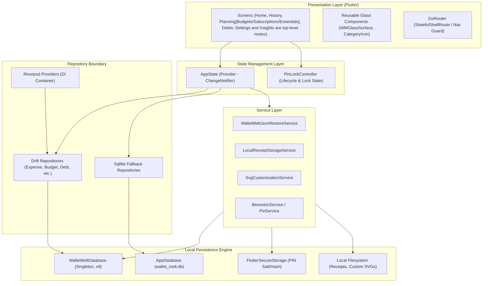

# Application Architecture

## 1. High-Level Architectural Diagram

## 2. Layer Responsibilities

1. **Presentation Layer (`lib/src/screens/`, `lib/src/components/`)**:
   - Strictly declarative UI widgets.
   - Watches `AppState` via `context.watch<AppState>()` or `Consumer`.
   - Never accesses database queries or sqlite connection handles directly.
2. **State Management (`lib/src/state/app_state.dart`)**:
   - Central application coordinator.
   - Dispatches mutations to Drift repositories, synchronizes fallback layers, and notifies listeners.
3. **Repository Layer (`lib/src/data/repositories/drift/`)**:
   - Implements domain repository contracts.
   - Maps raw database data classes to typed immutable domain objects.
4. **Local Persistence Engine (`lib/src/data/local/`)**:
   - `WalletMeltDatabase`: Drift SQLite engine managing connection pooling, schemas, foreign keys, and transactions.
   - `AppDatabase`: Legacy sqflite fallback.
